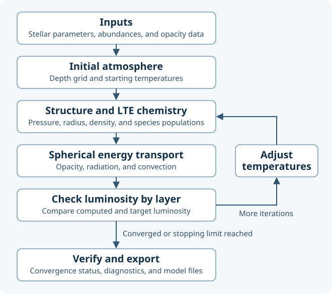

# How GiantLayers works

GiantLayers computes the layers of a cool giant's atmosphere. You supply the effective temperature, surface gravity, stellar mass, an elemental abundance mixture, and the wavelengths and opacity data for the calculation. The solver looks for a temperature and pressure structure that can carry the star's luminosity through the atmosphere.

## From inputs to an atmosphere

1. **Start with an estimate.** GiantLayers builds a grid in radial column mass, which measures the mass per unit area above each layer. By default it uses a simple gray temperature profile as a starting point. You can also restart the temperature profile from a previous calculation.
2. **Recompute the layers.** For each trial temperature profile, GiantLayers solves hydrostatic balance and local thermodynamic equilibrium (LTE) chemistry. These determine the radius, gas pressure, density, electron density, and chemical species populations as functions of depth. The species populations and the supplied opacity data determine how strongly each layer absorbs and scatters light.
3. **Calculate how much energy flows through each layer.** The solver follows rays through the spherical atmosphere to calculate radiative flux. It also estimates the energy carried by convection using mixing-length theory. It converts the combined flux at each radius to luminosity and compares it with the luminosity implied by the effective temperature and reference radius.
4. **Correct the temperatures and check the result.** The solver tests how changing temperatures at selected depths affects the luminosity residuals. It uses those responses to propose corrections and recomputes the structure and energy transport. A run can fit on a subset of the input wavelengths and then verify the final model on the full supplied grid.

## What to look for in the output

The CSV gives the residual by layer. A residual measures the difference between the computed and target luminosity, so check the largest residual across the atmosphere as well as the surface value. A run can reach its iteration limit and still write a model. The output includes the convergence status.

GiantLayers can also export MARCS, ATLAS9, and ATLAS12 atmosphere files for use in other tools. Its current physical scope is static, dust-free LTE atmospheres. The result depends on the depth and wavelength grids and the coverage of the supplied opacity data. Compare against a reference model or a higher-resolution run when establishing accuracy for a new part of parameter space.

[Run your first atmosphere](quickstart.md) · [Read the solver physics](spherical.md) · [See the validation benchmarks](validation.md)
